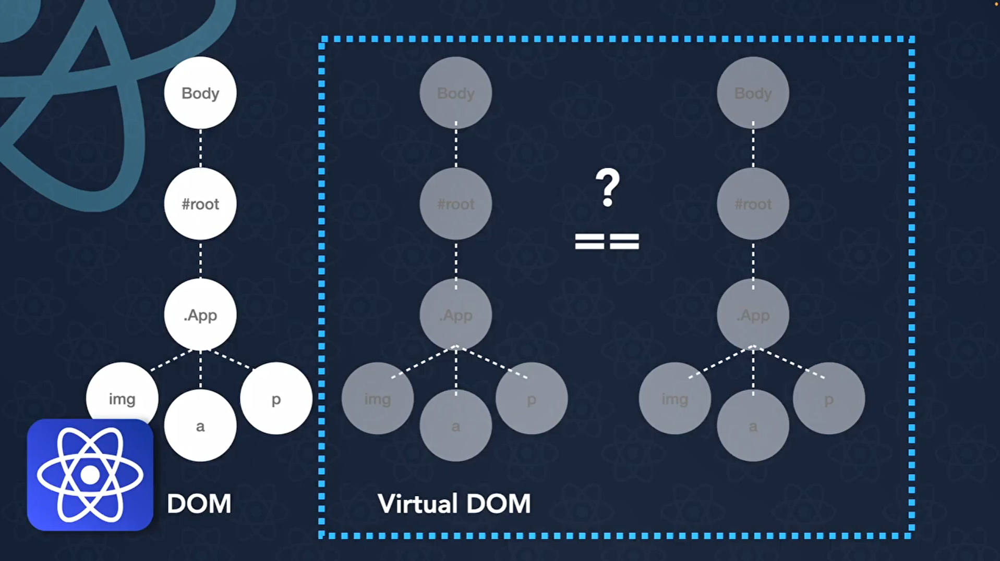
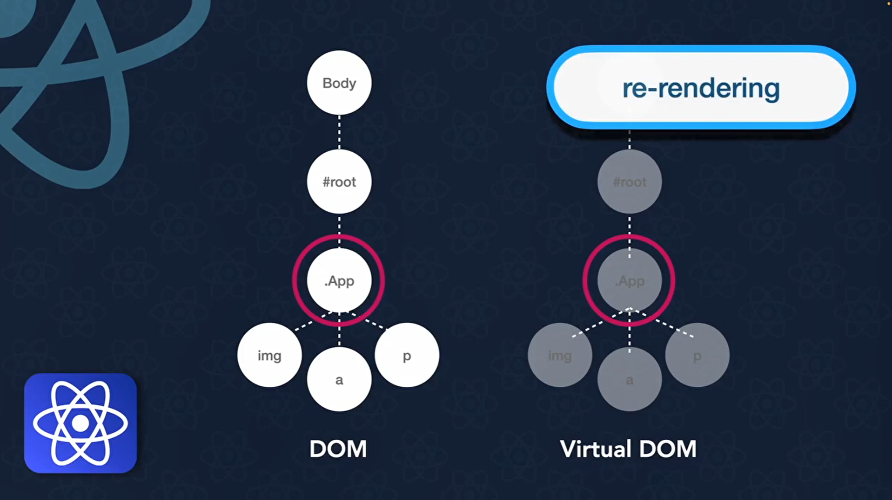
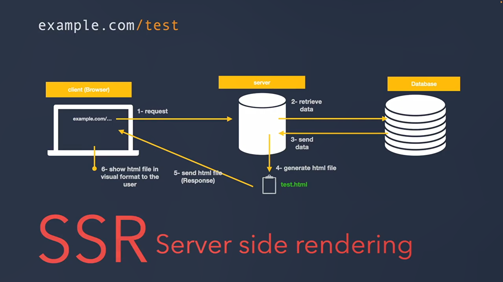
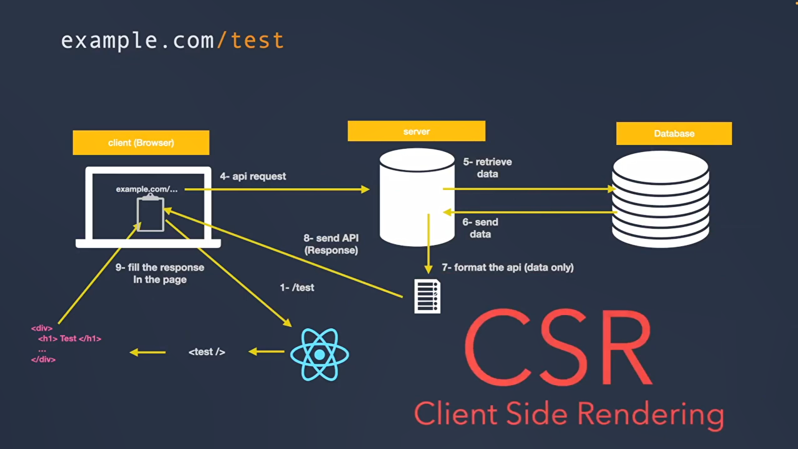
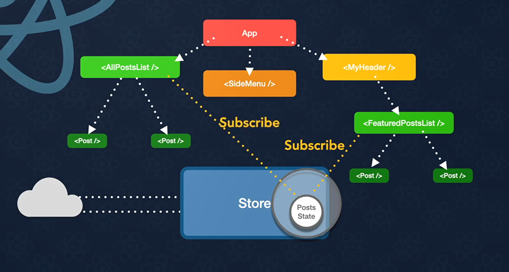
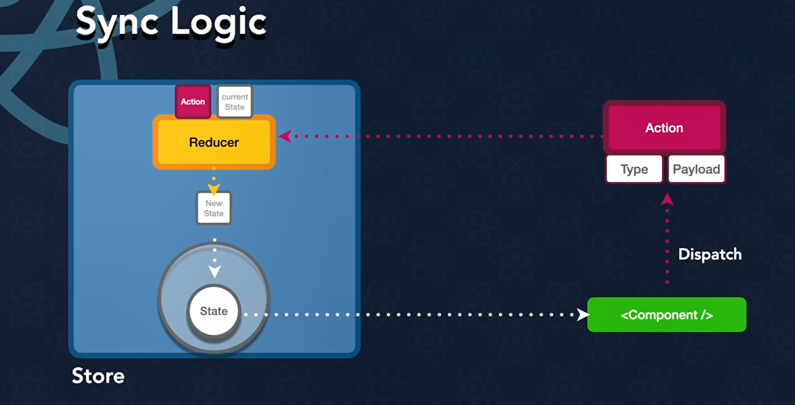
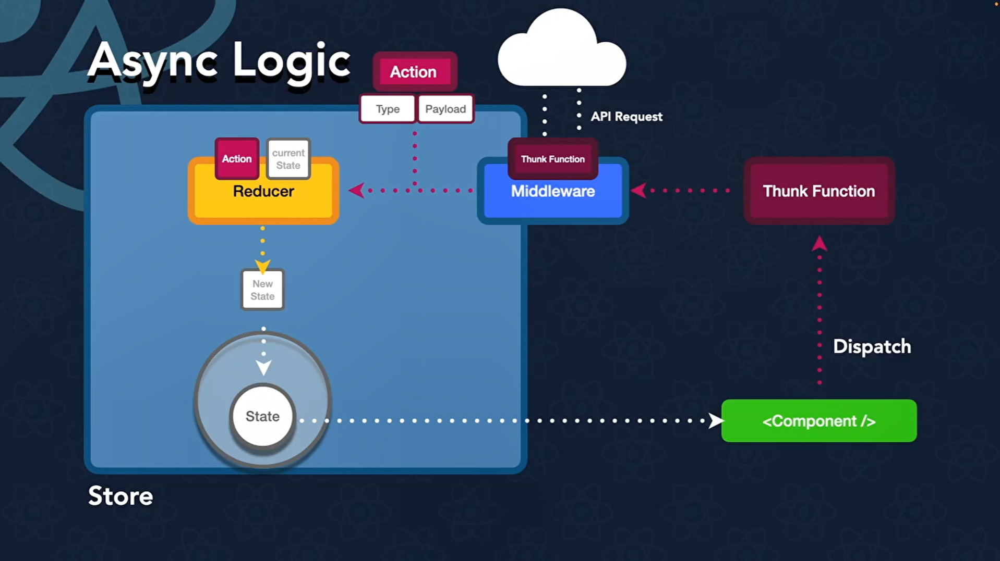

## **Create a React project**

- The following command creates a new React project inside a folder named my-app:
    - You can replace my-app with any name you prefer for your project or "." for current path.


```python
npx create-react-app my-app
```

- Main Project Folders and Files : 

    - **node_modules/** : Contains the packages and dependencies installed for the project to run React project properly.

    - **public/** : Contains static assets that are served directly without being processed by the bundler. For example, images, icons, or other files that need to be accessible using a direct URL.
     
    - **src/** : Contains the main source code of the React application. This is where you typically write React components, JavaScript/TypeScript files, CSS, and other application logic.
        - **App.jsx** : Contains the main React component of the application.
        ```js
            function App() { 
                return ( <p>Hello React!</p> ); 
                } 
            export default App;
         ```
        - **index.jsx** :Acts as the entry point of the React application.
        ```js
            import React from 'react';
            import ReactDOM from 'react-dom/client';
            import App from './App';

            const root = ReactDOM.createRoot(document.getElementById('root'));
            
            root.render(
                <App />
            );
         ```
    - **package.json** : Contains important information about the project, including its name, version, scripts, and the dependencies and development dependencies used by the project.

    - **package-lock.json** : Contains the exact versions of the dependencies and development dependencies used by the project.
     
    - **index.html** : The main HTML entry point of the application. It contains the root element where the React application is mounted.

- **Note:** The exact project structure can vary depending on the tool and options used to create the React project.

## **Running the React Project**


```python
npm start
```

- This command runs the `start` script defined in the project's `package.json` file:

```json
"scripts": {
  "start": "react-scripts start",
  "build": "react-scripts build",
  "test": "react-scripts test",
  "eject": "react-scripts eject"
}
```

- The `start` script executes:

```bash
react-scripts start
```

- This starts the **development server**, allowing you to run and preview the React application locally. The application is typically available at:

```text
http://localhost:3000
```

- Understanding the `scripts` section : 

  * **`npm run start`**
    Starts the development server.
  
  * **`npm run build`**
    Creates an optimized production build of the application.
  
  * **`npm run test`**
    Runs the project's tests.

## **What is a component in react?**
- A component is a reusable, independent part of a UI. It is usually a JavaScript function that returns JSX and helps divide an application into smaller, manageable parts.
- **App.js** : is called the root component of the application.


```python
// /src/Welcome.js
function Welcome({name}) { 
    return <h1>Welcome to React, {name}!</h1>; 
}

export default Welcome;

// /src/App.js
function App() { 
    return ( 
    <div> 
        <Welcome name="Alice" /> 
        <Welcome name="Bob" /> 
        <Welcome name="Charlie" /> 
    </div> 
    ); 
}

export default App;
```

- You can affect JSX code to a variable then used in the return.


```python
function App() {
  return (
    <>
    <Welcome name="Sidal" />
    </>
  );
}

function Welcome({ name }) {
    let greeting = <h1>Hello, {name}!</h1>;
  return greeting;
}

// Pay attention
function Welcome({ name }) {
    let greeting = <h1>Hello, {name}!</h1>;
  return {greeting}; // this return an object not a JSX
}

// Corrected version
function Welcome({ name }) {
    let greeting = <h1>Hello, {name}!</h1>;
  return (
    <>
    <div>some text</div>
    {greeting} {/* this is a JSX*/}
    </>
  );
}
```

- You have to return or affect only one JSX element (shown above).
- You can write a JS code along with JSX using curly brases.

- Attributes in JSX should be written in camelCase.
- For example, instead of using `class` for CSS classes, you should use `className`. Similarly, instead of `for` in labels, you should use `htmlFor`. This is because `class` and `for` are reserved keywords in JavaScript.


```python
<div className="my-class my-other-class" htmlFor="my-label">
  <label id="my-label">Label</label>
</div>
```

- Inline style in React is written this way.


```python
<div style={{ backgroundColor: 'red', fontSize: '20px' }}></div>
```

- Action listener functions are written in **camelCase** and passed as props to JSX elements. For example, instead of using `onclick`, you should use `onClick`.


```python
function App() {
    const handleClick = () => {
        alert('Button clicked!');
    };

    return (
        // The function should be passed by reference, not executed.
        <button onClick={handleClick}>Click Me</button>
    );
}
```

## **Props in React**

- Props simialar to function arguments.
- You can pass data or even a JSX elements to a component.


```python
function Welcome({ name="Guest", children }) {
  return (
    <>
        <h1>Welcome to React, {name}!</h1>
        {children}
    </>
  );
}

function App() {
    return (
        <Welcome name="Sidali">
            <>Some content</>
            <>Some other content</>
        </Welcome>
    );
}
```

## **Conditional rendering**


```python
function App() {
    const isAuthenticated = true;
    return (
        <div>
            {isAuthenticated ? (<h1>Authenticated</h1>) : (<h1>Not authenticated</h1>)}
        </div>
    );
}
```

## **List rendering**


```python
function App() {
    const tasks = [
        {title: "Task 1", discription: "Task 1 discription"},
        {title: "Task 2", discription: "Task 2 discription"},
        {title: "Task 3", discription: "Task 3 discription"},
    ]

    const TaskComponent = tasks.map((task, index) => {
        return <li key={index}>{task.title} : {task.discription}</li>
    })

    return (
        <div>
            <ul>
                {TaskComponent}
            </ul>
        </div>
    )
}
```

## **useState hook in React**

- **DOM (Document Object Model) :** is the browser's in-memory representation of the HTML document. It represents the page as a tree of objects that JavaScript can read and modify.

- **Re-rendering in React :** is the process of executing a component again to produce a new description of its UI, usually after its state or props change.

- **The Virtual DOM :** is a lightweight, in-memory representation of the UI that React uses to determine what changes need to be made to the real DOM.




- **Remark :** We use React Hooks when we need to manage state or other component-related data that can trigger a re-render. Regular JavaScript variables do not trigger re-renders when their values change. Relying only on normal variables can therefore cause a mismatch between the component's JavaScript logic and what is actually displayed in the DOM.

- **useState method :** return  an array with two elements. The first element is the current state value, and the second element is a function that updates the state value.


```python
function App() {
    const [count, setCount] = useState(0);
    return (
        <div>
            <p>Count: {count}</p>
            <button onClick={() => setCount(count + 1)}>Increment</button>
        </div>
    );
}
```

### **Link from field with state**


```python
function App() {
  const [formData, setFormData] = useState({
    name: "",
    message: "",
    checkbox01: false,
    checkbox02: false,
    checkbox03: false,
    radio: "option01",
    select: "option01",
  });
  return (
    <>
    <form onSubmit={
      (event) =>{
        event.preventDefault();
        console.log(formData);
        
      }
    }>
      {/* text field */}
      <input 
        type="text" 
        placeholder="Enter your name" 
        value={formData.name} 
        onChange={(event) => {
          setFormData({...formData, name : event.target.value})
        }}  />

      {/* text area */}
      <div>
        <textarea 
        placeholder="Enter your message 01"
        value={formData.message}
        onChange={(event) => {
          setFormData({...formData, message : event.target.value})
        }}
        ></textarea>

      </div>

      {/* check box */}
      <div>
        <input 
          type="checkbox" 
          id="checkbox01"
          checked={formData.checkbox01}
          onChange={(event) => {
            setFormData({...formData, checkbox01 : event.target.checked})
          }}/>
        <label htmlFor="checkbox01">Check Box 01</label>

        <input 
          type="checkbox" 
          id="checkbox02" 
          checked={formData.checkbox02}
          onChange={(event) => {
            setFormData({...formData, checkbox02 : event.target.checked})
          }}/>
        <label htmlFor="checkbox02">Check Box 02</label>

        <input 
          type="checkbox" 
          id="checkbox03"
          checked={formData.checkbox03}
          onChange={(event) => {
            setFormData({...formData, checkbox03 : event.target.checked})
          }} />
        <label htmlFor="checkbox03">Check Box 03</label>
      </div>

      {/* radio button */}
      <div>
        <input 
          type="radio" 
          id="radio01"
          checked={formData.radio === "option01"}
          onChange={(event) => {
            if (event.target.checked === true) {
              setFormData({...formData, radio : "option01"})
            }
          }} />
        <label htmlFor="radio01">Radio Button 01</label>

        <input 
          type="radio" 
          id="radio02"
          checked={formData.radio === "option02"}
          onChange={(event) => {
            if (event.target.checked === true) {
              setFormData({...formData, radio : "option02"})
            }
          }} />
        <label htmlFor="radio02">Radio Button 02</label>

        <input 
          type="radio" 
          id="radio03"
          checked={formData.radio === "option03"}
          onChange={(event) => {
            if (event.target.checked === true) {
              setFormData({...formData, radio : "option03"})
            }
          }} />
        <label htmlFor="radio03">Radio Button 03</label>
      </div>

      {/* select */}
      <select
        value={formData.select}
        onChange={(event) => {
          setFormData({...formData, select : event.target.value})
        }}
      >
        <option value="option01">Option 01</option>
        <option value="option02">Option 02</option>
        <option value="option03">Option 03</option>
      </select>

      <input type="submit" />
    </form>
    </>
  );
}
```

### **CRUD Operations example with state**


```python
import { useState } from "react";

function App() {
  const [devices, setDevices] = useState([
    "iPhone",
    "Windows",
    "HP"
  ]);

  const [newDevice, setNewDevice] = useState("");
  const [editingIndex, setEditingIndex] = useState(null);
  const [editingValue, setEditingValue] = useState("");

  // CREATE
  function addDevice() {
    const value = newDevice.trim();

    if (!value) return;

    setDevices(prevDevices => [
      ...prevDevices,
      value
    ]);

    setNewDevice("");
  }

  // DELETE
  function deleteDevice(index) {
    setDevices(prevDevices =>
      prevDevices.filter((_, i) => i !== index)
    );
  }

  // Start editing
  function startEditing(index) {
    setEditingIndex(index);
    setEditingValue(devices[index]);
  }

  // UPDATE
  function updateDevice() {
    const value = editingValue.trim();

    if (!value || editingIndex === null) return;

    setDevices(prevDevices =>
      prevDevices.map((device, index) =>
        index === editingIndex
          ? value
          : device
      )
    );

    setEditingIndex(null);
    setEditingValue("");
  }

  // Cancel editing
  function cancelEditing() {
    setEditingIndex(null);
    setEditingValue("");
  }

  return (
    <div>
      <h1>Device Manager</h1>

      {/* Device list */}
      <ul>
        {devices.map((device, index) => (
          <li key={index}>
            {editingIndex === index ? (
              <>
                <input
                  type="text"
                  value={editingValue}
                  onChange={e => setEditingValue(e.target.value)}
                />

                <button onClick={updateDevice}>
                  Save
                </button>

                <button onClick={cancelEditing}>
                  Cancel
                </button>
              </>
            ) : (
              <>
                <span>{device}</span>

                <button onClick={() => startEditing(index)}>
                  Edit
                </button>

                <button onClick={() => deleteDevice(index)}>
                  Delete
                </button>
              </>
            )}
          </li>
        ))}
      </ul>

      {/* Add device */}
      <div>
        <input
          type="text"
          placeholder="Enter device name"
          value={newDevice}
          onChange={e => setNewDevice(e.target.value)}
        />

        <button onClick={addDevice}>
          Add
        </button>
      </div>
    </div>
  );
}

export default App;
```

### **Sequential update of state**


```python
function App() {
    const [count, setCount] = useState(0);
    function handleIncrement() {
        setCount(count + 1);
        // The following line will use the old value of count (snapshot value)
        // setCount(count + 1);
        // The following line will use the new value of count from previous state (current value)
        setCount(prev => prev + 1);
    }
    return (
        <div>
            <p>Count: {count}</p>
            <button onClick={handleIncrement}>Increment twice</button>
        </div>
    );
}
```

### **Loan form project (example)**


```python
// App.js
import { LoanForm } from "./LoanForm";
import { DialogPannel } from './DialogPannel';
import { useState } from "react";

function App() {
    const [sharedData, setSharedData] = useState(null);
    const [hide, setHide] = useState(false)
    return (
        <div>
            {/* It should Send eventHandler instead of changing the 
            state from child as it increase dependency (components sould be Independent) */}
            <LoanForm setSharedData={setSharedData} setHide={setHide} />
            { (sharedData !== null)?
                <DialogPannel sharedData={sharedData} hide={hide} setHide={setHide} /> : null
            }
        </div>
    );
}

export default App;
```


```python
// LoanForm.js
import { useState } from 'react'
import './ComponentsStyle.css'
import { InputComponent } from './InputComponent';
export function LoanForm ({setSharedData, setHide}) {
    const [formData, setFormData] = useState({
        name : "",
        phone : "",
        age : "",
        employer: "No",
        salary: "Less than 500$"
    });
    function handleNameChange(value) {
        setFormData({...formData, name : value})
    }
    function handlePhoneNumberChange(value) {
        setFormData({...formData, phone : value})
    }
    function handleAgeChange(value) {
        setFormData({...formData, age : value})
    }

    // Disable the submit button if any of the fields are empty
    const btnDisable = !formData.name || !formData.phone || !formData.age
    return (
    <>
        <form onSubmit={(e) => e.preventDefault()}>
            <h1>Request a Loan</h1>
            <hr />
            {/* Send eventHandler to the child component */}
            <InputComponent
                inputName="Name"
                value={formData.name} 
                handleChange={handleNameChange} 
            />
            <InputComponent
                inputName="Phone Number"
                value={formData.phone} 
                handleChange={handlePhoneNumberChange} 
            />
            <InputComponent 
                inputName="Age"
                value={formData.age} 
                handleChange={handleAgeChange} 
            />
            
            <div className="field">
                <div >Are you an employer?</div>
                <input 
                    type="radio" 
                    id="radio1"
                    checked = {formData.employer === "Yes"}
                    onChange={(e) => {
                        if (e.target.checked === true) {
                            setFormData({...formData, employer : "Yes"})
                        }                        
                    }}
                />
                <label htmlFor="radio1">Yes</label>
                <input 
                    type="radio" 
                    id="radio2"
                    checked = {formData.employer === "No"}
                    onChange={(e) => {
                        if (e.target.checked === true) {
                            setFormData({...formData, employer : "No"})
                        }
                    }}
                />
                <label htmlFor="radio2">No</label>
            </div>
            
            <div className="field">
                <select
                    value={formData.employer}
                    onChange={(e) => {
                        setFormData({...formData, salary : e.target.value})
                    }}
                >
                  <option >Less than 500$</option>
                  <option >Between 500$ & 2500$</option>
                  <option >More than 2500$</option>
                </select>
            </div>
            <button 
                type="submit" 
                disabled={btnDisable}
                className={(btnDisable)? "disabledButton" : "enabledButton"}
                onClick={() => {
                    console.log(btnDisable);
                    
                    setSharedData (formData);
                    setHide(false);
                }}
            >
                Submit
            </button>
        </form>
    </>
    )
}
```


```python
// InputComponent.js
export function InputComponent({inputName, value, handleChange}) {
    return (
        <div className="field">
            <div>{inputName}</div>
            <input 
                type="text" 
                placeholder={"Enter your " + inputName }
                value={value}
                onChange={(e) => handleChange(e.target.value)} 
            />
        </div>
    );
}
```


```python
// DialogPannel.js
import { useState } from 'react';
import './DialogStyle.css';

export function DialogPannel ({sharedData, hide, setHide}) {
    const errors = validateData(sharedData);
    const isValid = Object.keys(errors).length === 0;
    return (
    <div 
        className='validation' 
        style={(hide === true)? {display: "none"} : {display: 'flex'}}
        onClick={(e) =>setHide(true)}
    >
      {isValid ? (
        <p>All data is valid.</p>
      ) : (
        <ul>
          {Object.entries(errors).map(([field, message]) => (
            <li key={field}>
              {message}
            </li>
          ))}
        </ul>
      )}
    </div>
  );
}

function validateData(data) {
  const errors = {};

  // =========================
  // Name
  // =========================

  if (!data.name?.trim()) {
    errors.name = "Name is required";
  } else if (!/^[\p{L}\s]+$/u.test(data.name.trim())) {
    errors.name = "Name must contain letters only";
  }


  // =========================
  // Phone
  // =========================

  if (!data.phone?.trim()) {
    errors.phone = "Phone number is required";
  } else {
    const phone = data.phone.trim();

    // Must contain only + followed by digits
    if (!/^\+\d+$/.test(phone)) {
      errors.phone =
        "Phone must start with + and contain digits only";
    } else {
      // Remove +
      const digits = phone.slice(1);

      // Country code: 1–3 digits
      // Local number: maximum 10 digits
      //
      // Total digits therefore:
      // minimum = 2
      // maximum = 13
      if ( digits.length === 13) {
        errors.phone =
          "Phone must contain a country code and no more than 10 local digits";
      }
    }
  }


  // =========================
  // Age
  // =========================

  if (data.age === "" || data.age === undefined) {
    errors.age = "Age is required";
  } else if (!/^\d+$/.test(String(data.age))) {
    errors.age = "Age must contain numbers only";
  } else {
    const age = Number(data.age);

    if (age < 18 || age > 100) {
      errors.age = "Age must be between 18 and 100";
    }
  }


  // =========================
  // Employer
  // =========================

  if (!data.employer?.trim()) {
    errors.employer = "Employer is required";
  }


  // =========================
  // Salary
  // =========================

  if (data.salary === "" || data.salary === undefined) {
    errors.salary = "Salary is required";
  }

  return errors;
}
```

## **useContext hook in React**

- useContext hook is used to access the value of a context from a React component. It is a way to share data between components without passing props down the component tree (props drilling problem).

### **1. Create the Context**
- First, we need to create a **Context object**. React provides the `createContext()` function for this purpose.

- The context will act as a shared container for data that we want to make available to different components without having to pass that data manually through props.
    
- Here, we create a context named `profileContext`. The empty object `{}` is the default value of the context. This value is used also when a component consumes the context.


```python
import { createContext } from "react";

export const profileContext = createContext({});
```

### **2. Provide Data Through the Context**

- Creating the context alone is not enough. We now need to make some data available through it.

- React provides the `Provider` associated with every context we create. We wrap the components that need access to the shared data with this Provider.

- The `value` prop contains the data that we want to make available to all descendant components.

- In this example, we make `name` and `phone` available to the components inside the Provider.


```python
// App.js

import { profileContext } from "./Context";
import { Son } from "./Son";

function App() {
    return (
        <profileContext.Provider
            value={{
                name: "Sidali",
                phone: "+213512345678"
            }}
        >
            <Son />
        </profileContext.Provider>
    );
}

export default App;
```

- The important point here is that **every component inside the Provider can access the value**, even if the data is not passed to it through props.

### **3. Pass the Component Through the Component Tree**

Now let's introduce an intermediate component. `App` renders `Son`, and `Son` renders `GrandSon`.
Notice that we don't pass `name` or `phone` as props to `Son`. This is important because it demonstrates the problem that Context is designed to solve: data can be made available to deeply nested components without manually passing it through every intermediate component.


```python
// Son.js

import { GrandSon } from "./GrandSon";

export function Son() {
    return (
        <>
            <GrandSon />
        </>
    );
}
```

The component hierarchy is therefore:

```text
App
 └── Son
      └── GrandSon
```

Even though `GrandSon` is two levels below `App`, it can still access the context data.

### **4. Consume the Context with `useContext`**

- Finally, we need to retrieve the data from the context.
- React provides the `useContext` Hook for this purpose.
- We import `useContext` and pass our `profileContext` to it:

```jsx
const { name, phone } = useContext(profileContext);
```
- `useContext(profileContext)` returns the value currently provided by the nearest `profileContext.Provider`.

- Since our Provider contains:

```jsx
{
    name: "Sidali",
    phone: "+213512345678"
}
```

- the `useContext` call gives us access to those properties.


```python
// GrandSon.js

import { useContext } from "react";
import { profileContext } from "./Context";

export function GrandSon() {
    const { name, phone } = useContext(profileContext);

    return (
        <h1>
            My name is {name} and my phone number is {phone}
        </h1>
    );
}
```

### **The complete flow**

At this point, the complete process can be summarized as:

```text
1. createContext()
       ↓
2. Create a Provider
       ↓
3. Put the shared data in the Provider's value
       ↓
4. Wrap the components that need the data
       ↓
5. useContext()
       ↓
6. Access the shared data
```


## **React-Router**

- Modern React applications are usually built as **Single Page Applications (SPA)**. Instead of loading a new HTML page every time the user navigates to another section of the website, React updates only the necessary parts of the page.

- To handle navigation between different pages (or views), React applications commonly use the **React Router** library.

- Before using React Router, install it with the following command:


```python
npm install react-router-dom
```

### **Creating the Application Routes**

The first step is to configure the router and define all available routes.

React Router provides several components that help us achieve this:

* **BrowserRouter**: Enables routing inside the application.
* **Routes**: Container that holds all route definitions.
* **Route**: Defines a URL path and the component that should be rendered.
* **Link**: Used to navigate between routes without reloading the page.


```python
// App.js
import { PostsContext } from "./Context";
import { postData } from "./utils";
import { BrowserRouter, Route, Routes, Link } from "react-router-dom"
import Home from "./pages/Home";
import Posts from "./pages/Posts";
import ContactUs from "./pages/ContactUs";
import PostsDetails from "./pages/PostsDetails";
import NewPosts from "./pages/NewPosts";
import DeletePosts from "./pages/DeletePosts";
import PostsLayout from "./pages/PostsLayout";
import NotFound from "./pages/NotFound";

function App() {

    return (
        <>
        <p>ADs played here</p>
        <PostsContext.Provider value={postData}>
            <BrowserRouter>
            <div>
                <Link to="/home">
                    <button>Home</button>
                </Link>
                <Link to="/posts">
                    <button>Posts</button>
                </Link>
                <Link to="/contact">
                    <button>Contact Us</button>
                </Link>
            </div>

            <Routes>
                <Route path="/home"  element={<Home />}/>
                <Route path="/posts"  element={<PostsLayout />}>
                    <Route index  element={<Posts />}/>
                    <Route path=":postId"  element={<PostsDetails />}/>
                    <Route path="new"  element={<NewPosts />}/>
                    <Route path="delete"  element={<DeletePosts />}/>
                </Route>
                <Route path="/contact"  element={<ContactUs />}/>
                <Route path="*"  element={<NotFound />}/>
            </Routes>
            </BrowserRouter>
        </PostsContext.Provider>
        </>
    );
}

export default App;
```


```python
// /pages/Home.js
export default function Home() {
    return (
        <>
            <h1>This is the Home Page</h1>
        </>
    )
}
```


```python
// /pages/PostsLayout.js
import { Outlet } from "react-router-dom"
export default function PostsLayout() {
    return (
        <>
            <h1 style={{backgroundColor: "red"}}>This is the Posts Layout</h1>
            <Outlet />
            <h1 style={{backgroundColor: "red"}}>This is the Posts Layout</h1>
        </>
    )
}
```


```python
// /pages/Posts.js
import { Link } from "react-router-dom"
import { useContext } from "react"
import { PostsContext } from "../Context"
export default function Posts() {
    const posts = useContext(PostsContext)
    return (
        <>
            <h1>This is the Posts Page</h1>
            <Link to="/posts/new">
                    <button>Create</button>
            </Link>
            <Link to="delete">
                    <button>Delete</button>
            </Link>
            <ul>
            {posts.map((p) => (
                <Link key={p.id} to={"/posts/" + p.id}>
                    <li style={
                        {
                            fontSize : "20px",
                            margin : "10px",
                            background : "black",
                            color : "white"
                        }}>                        
                        {p.title}
                    </li>
                </Link>
            ))}
            </ul>
        </>
    )
}
```


```python
// /pages/PostsDetails.js
import { useContext } from "react"
import { PostsContext } from "../Context"
import { useParams } from "react-router-dom"
export default function PostsDetails() {
    const allPosts = useContext(PostsContext);
    const {postId} = useParams();

    const post = allPosts.find((p) =>{
        return p.id === +postId
    })

    if(!post){
        return <h1>Post not found</h1>
    }

    return (
        <div style={{margin : "20px", padding : "20px"}}>
            <h1>{post.title}</h1>
            <div>{post.body}</div>
        </div>
    )
}
```


```python
// /pages/NewPosts.js
export default function NewPosts() {
    return (
        <>
            <h1>This is the Create Posts Page</h1>
            <button>Create</button>
        </>
    )
}
```


```python
// /pages/DeletePosts.js
export default function DeletePosts() {
    return (
        <>
            <h1>This is the Delete Posts Page</h1>
            <button>Delete</button>
        </>
    )
}
```


```python
// /pages/ContactUs.js
export default function ContactUs() {
    return (
        <>
            <h1>This is the Contact Us Page</h1>
        </>
    )
}
```


```python
// /pages/NotFound.js
export default function NotFound() {
    return (
        <>
            <h1>This is the Not Found Page</h1>
        </>
    )
}
```

### **SSR : Server Side Rendering**


### **CSR : Client Side Rendering**


## **useEffect hook in React**

`useEffect` is a React Hook used to perform **side effects after a component renders**.

A **side effect** is an operation that is not part of calculating what the component should render. For example:

* Making an API request
* Setting up or removing an event listener
* Starting or cleaning up a timer
* Working with browser APIs
* Synchronizing with an external system
* Subscribing/unsubscribing to something
* Reading or writing certain browser storage mechanisms


```python
import { useEffect } from "react";

function App() {

    useEffect(() => {
        console.log("Effect executed");
    });

    return <h1>Hello</h1>;
}
```

Here, the effect runs **after every render** because no dependency array was provided.

### **Dependency Array**

`useEffect` accepts a second argument called the **dependency array**.

```jsx
useEffect(() => {
    // side effect
}, [dependencies]);
```

React uses the dependencies to determine **when the effect needs to run again**.

#### 1. **No dependency array**
The effect runs after **every render**.


```python
useEffect(() => {
    console.log("Effect executed");
});
```

#### 2. **Empty dependency array**

The effect runs after the component's **initial render** and does not run again because there are no dependencies that can change.


```python
useEffect(() => {
    console.log("Effect executed");
}, []);
```

A common use case is initialization:


```python
useEffect(() => {
    fetch("https://example.com/api/users")
        .then(response => response.json())
        .then(data => console.log(data));
}, []);
```

#### 3. **Dependency array with values**

Now the effect runs after the initial render and whenever `count` changes.


```python
function App() {

    const [count, setCount] = useState(0);

    useEffect(() => {
        console.log("count:", count);
    }, [count]);

    return (
        <button onClick={() => setCount(count + 1)}>
            {count}
        </button>
    );
}
```

## **useMemo hook in React**

`useMemo` is a React Hook used to **cache the result of an expensive calculation** between renders.

Normally, when a component re-renders, all of the JavaScript inside the component is executed again.

For example:


```python
function App() {
    const [count, setCount] = useState(0);

    const result = expensiveCalculation();

    return (
        <div>
            <p>{result}</p>
            <button onClick={() => setCount(count + 1)}>
                {count}
            </button>
        </div>
    );
}
```

Every time `count` changes, the component re-renders, which means:

```text
count changes
     ↓
component re-renders
     ↓
expensiveCalculation()
     ↓
calculation runs again
```

If the calculation is expensive and its result does not need to change every time the component renders, we can use `useMemo`.

### **Basic Syntax**

```jsx
const value = useMemo(() => {
    return calculation;
}, [dependencies]);
```
The first argument is a **function containing the calculation**.

The second argument is the **dependency array**.

React stores the result of the calculation and reuses it until one of the dependencies changes.


```python
function App() {
    const [number, setNumber] = useState(10);
    const [count, setCount] = useState(0);

    const doubledNumber = useMemo(() => {
        console.log("Calculating...");

        return number * 2;
    }, [number]);

    return (
        <div>
            <p>Number: {number}</p>
            <p>Doubled: {doubledNumber}</p>

            <button onClick={() => setNumber(number + 1)}>
                Change Number
            </button>

            <button onClick={() => setCount(count + 1)}>
                Count: {count}
            </button>
        </div>
    );
}
```

When `number` changes:

```text
number changes
      ↓
Re-render
      ↓
number is a dependency
      ↓
useMemo recalculates
```

But when only `count` changes:

```text
count changes
      ↓
Re-render
      ↓
number hasn't changed
      ↓
useMemo returns the cached result
```

So the expensive calculation does not need to be performed again.


## **useReducer hook in React**

`useReducer` is a Hook for managing complex state logic by dispatching actions to a reducer function, which determines the next state. It is an alternative to `useState`, especially when the state logic becomes more complex.

### **Basic syntax**


```python
const [state, dispatch] = useReducer(reducer, initialState);
```

There are three important parts:

* **`state`** → the current state
* **`dispatch`** → a function used to send an action
* **`reducer`** → a function that determines how the state should change
* **`initialState`** → the initial value of the state

### **Basic Example**


```python
import { useReducer } from "react";

function reducer(state, action) {

    if (action.type === "increment") {
        return state + 1;
    }

    if (action.type === "decrement") {
        return state - 1;
    }

    return state;
}

function App() {

    const [count, dispatch] = useReducer(reducer, 0);

    return (
        <div>
            <p>Count: {count}</p>

            <button onClick={() => dispatch({ type: "increment" })}>
                +
            </button>

            <button onClick={() => dispatch({ type: "decrement" })}>
                -
            </button>
        </div>
    );
}
```

When the user clicks `+`:

```text
Click +
   ↓
dispatch({ type: "increment" })
   ↓
reducer(state, action)
   ↓
action.type === "increment"
   ↓
return state + 1
   ↓
React updates state
   ↓
Component re-renders
```

### **Reducers Should Be Pure**

Avoid performing side effects inside the reducer, such as:


```python
function reducer(state, action) {

    // ❌ Don't make API requests here
    fetch("/api/users");

    // ❌ Don't modify the DOM here
    document.title = "Hello";

    // ❌ Don't modify external variables here

    return state;
}
```

## **Redux**

- **Redux** is a JavaScript library for managing **global application state**.
- Instead of keeping important data inside individual React components, Redux provides a **centralized store** (a single source of truth) where application state can be stored and managed.
- Today, the recommended way to use Redux is **Redux Toolkit (RTK)**.



**Remark :** Redux is not necessary for every React application. For simple local state, `useState` is often enough.

### **Install**


```python
npm install @reduxjs/toolkit react-redux
```

### **Sync Logic**

Use this when the state changes immediately from a user action.




#### **Sync workflow**

```text
Component
    ↓
 dispatch(action)
    ↓
  Reducer
    ↓
   Store
    ↓
useSelector()
    ↓
Component updates
```


```python
// dataSlice.js

import { createSlice } from "@reduxjs/toolkit";

const dataSlice = createSlice({
  name: "data",

  initialState: {
    value: "Old Data",
  },

  reducers: {
    changeState: (state, action) => {
      state.value = action.payload;
    }
  },
});

export const { changeState } = dataSlice.actions;

export default dataSlice.reducer;
```


```python
// store.js

import { configureStore } from "@reduxjs/toolkit";
import dataReducer from "./dataSlice";

const store = configureStore({
  reducer: {
    data: dataReducer,
  },
});

export default store;
```


```python
// index.jsx

import React from 'react';
import ReactDOM from 'react-dom/client';
import App from './App';
import store from './store'
import { Provider } from 'react-redux'

const root = ReactDOM.createRoot(document.getElementById('root'));
root.render(
  <React.StrictMode>
    <Provider store={store}>
      <App />
    </Provider>
  </React.StrictMode>
);
```


```python
// App.jsx

import { useSelector, useDispatch } from "react-redux";
import { changeState } from "./dataSlice";

function App() {
  const resultData = useSelector((state) => state.data.value);
  const dispatch = useDispatch();

  return (
    <>
      <h1>{resultData}</h1>

      <button onClick={() => dispatch(changeState("New Data"))}>
        Change
      </button>

    </>
  );
}

export default App;

```

**Remark :** You can mutate the state inside a reducer even though Redux state is normally immutable. RTK uses **Immer** to handle the immutable update internally.

### **Async Logic**

Use this when the state changes asynchronously from a user action.



#### **Async workflow**

```text
Component
    ↓
dispatch(asyncThunk)
    ↓
   API request
    ↓
pending / fulfilled / rejected
    ↓
   Store
    ↓
useSelector()
    ↓
Component updates
```


```python
// usersSlice.js

import {
  createSlice,
  createAsyncThunk,
} from "@reduxjs/toolkit";

export const fetchUsers = createAsyncThunk(
  "users/fetchUsers",

  async () => {
    const response = await fetch(
      "https://fake-json-api.mock.beeceptor.com/users"
    );

    return await response.json();
  }
);

const usersSlice = createSlice({
  name: "users",

  initialState: {
    data: [],
    loading: false,
    error: null,
  },

  reducers: {},

  extraReducers: (builder) => {
    builder

      .addCase(fetchUsers.pending, (state) => {
        state.loading = true;
      })

      .addCase(fetchUsers.fulfilled, (state, action) => {
        state.loading = false;
        state.data = action.payload;
      })

      .addCase(fetchUsers.rejected, (state) => {
        state.loading = false;
        state.error = "Failed to fetch users";
      });
  },
});

export default usersSlice.reducer;

```


```python
// store.js

import { configureStore } from "@reduxjs/toolkit";
import usersReducer from "./usersSlice";

const store = configureStore({
  reducer: {
    users: usersReducer,
  },
});

export default store;
```


```python
// App.jsx

import { useSelector, useDispatch } from "react-redux";
import { fetchUsers } from "./usersSlice";

function App() {
  const dispatch = useDispatch();

  const { data, loading, error } = useSelector(
    (state) => state.users
  );

  return (
    <>
      <button onClick={() => dispatch(fetchUsers())}>
        Fetch Users
      </button>

      {loading && <p>Loading...</p>}
      {error && <p>{error}</p>}

      {data.map((user) => (
        <p key={user.id}>{user.name}</p>
      ))}
    </>
  );
}

export default App;
```


```python
// index.jsx
import React from 'react';
import ReactDOM from 'react-dom/client';
import App from './App';
import store from './store'
import { Provider } from 'react-redux'

const root = ReactDOM.createRoot(document.getElementById('root'));
root.render(
  <React.StrictMode>
    <Provider store={store}>
      <App />
    </Provider>
  </React.StrictMode>
);
```


```python
!jupyter nbconvert --to html React_cours.ipynb
```

    [NbConvertApp] Converting notebook React_cours.ipynb to html
    [NbConvertApp] WARNING | Alternative text is missing on 7 image(s).
    [NbConvertApp] Writing 502510 bytes to React_cours.html
    


```python
!jupyter nbconvert --to markdown React_cours.ipynb
```
